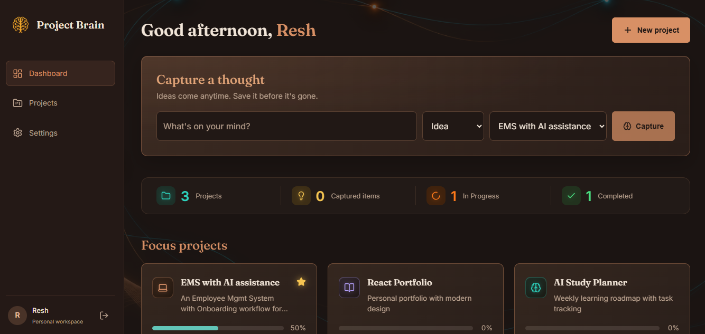

# Project Brain

A personal project workspace for capturing ideas, tracking progress and keeping notes.
Built with React, React Router and CSS Modules.

**Live demo:** https://your-app.vercel.app

## Features

- Sign up and log in (accounts are stored in your browser)
- Create projects, pin favourites and track progress
- Capture ideas, tasks and bugs, and change their status
- Search and filter items
- Notes for each project
- Responsive layout for phones and desktops

## Tech stack

React, Vite, React Router, CSS Modules, lucide-react

## Run locally

    npm install
    npm run dev

## Important note

Data is stored in your browser only (localStorage). There is no server, so your
data isn't shared between devices, and clearing browser data removes it.
Passwords are hashed in the browser, but this is a demo and not real security.